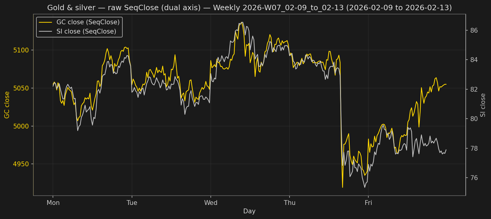
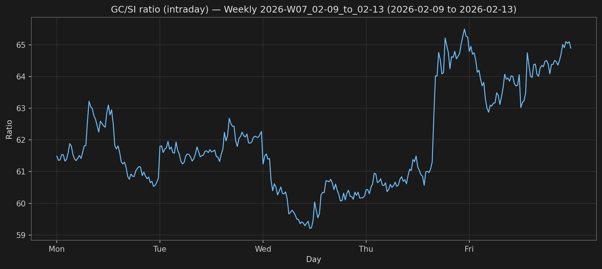

# Gold / silver ratio

Does the gold/silver price ratio mean-revert, and does a dollar-neutral spread around that reversion make money on daily closes?

The published numbers below come from 15-minute gold (GC) and silver (SI) bars covering **11 Aug 2016 through 11 Mar 2026**. Raw files are not in this repo. The tables in `results/` are the study output.

## Data

Scripts expect two CSVs with the same columns and matching timestamps. The default paths are `../gc-si/GC.csv` and `../gc-si/SI.csv` (a `gc-si/` folder next to this one). Pass `--gc` and `--si` to point elsewhere.

| Column | Role |
|--------|------|
| `Year`, `Month`, `Day` | Calendar date |
| `HourOfDay`, `MinOfHour` | Bar time. Bars are 15 minutes. |
| `SeqOpen`, `SeqHigh`, `SeqLow`, `SeqClose` | OHLC for that bar. Charts and backtests use `SeqClose`. |
| `DayOfWeek`, `output`, `outputC` | Present in the source files. Unused. |

GC and SI are inner-joined on `Year, Month, Day, HourOfDay, MinOfHour`. A bar that exists in only one file is dropped. The ratio is `close_gc / close_si`.

A **session close** in the daily studies is the last merged bar of that calendar day. The baseline for μ and σ is the prior ISO week (Monday–Friday) only, so the signal day is not inside its own mean and standard deviation.

Install:

```bash
pip install -r gc-si-correlation/requirements-plot.txt
```

Python 3.10+ (the scripts use `list[str]` and similar). Run commands from the repository root. Pandas and Matplotlib are enough; the backtests also import NumPy, which those packages already pull in.

## Charts

`plot_gc_si.py` writes the price overlay and the intraday ratio for one session. `plot_gc_si_weekly.py` writes the same two for the ISO Monday–Friday week that contains `--day`. The pictures below are the weekly set for **2026-W07 (9–13 Feb 2026)**.

### 1. Price overlay

GC `SeqClose` on the left axis, SI `SeqClose` on the right. The weekly chart drops the overnight gaps and labels the x-axis by weekday.



### 2. Intraday ratio

`close_gc / close_si` over the same bars. `--ratio-ylim MIN MAX` fixes this axis only.



```bash
python gc-si-correlation/plot_gc_si.py --day 2026-02-11
python gc-si-correlation/plot_gc_si_weekly.py --day 2026-02-11
```

| Flag | Role |
|------|------|
| `--day` | Required. `YYYY-MM-DD`. |
| `--gc`, `--si` | CSV paths. |
| `--out-dir` | PNG directory. Default `gc-si-correlation/plots/`. |
| `--ratio-ylim` | Two floats. Figure 2 only. |

The weekly script takes `--day`, `--gc`, `--si`, `--out-dir`, and `--ratio-ylim`.

## Reversion study

`analyze_gc_si_ratio_reversion_daily.py`: For each session it builds μ and σ from the prior ISO week’s daily ratios. An event starts when the ratio leaves the band μ ± kσ (k = 1.5 or 2.0) and ends at the first later close back inside that same band.

`DurationDays` is the revert index minus the cross index. A cross on Monday that is back inside on Wednesday is 2 days.

Every event in this sample reverted. Nothing was still outside the band at the end of the file. The full table is `results/reversion_duration_backtest/gc_si_ratio_reversion_daily_summary.csv`. A year-by-year split is in `gc_si_ratio_reversion_daily_by_year.csv` next to it.

| Trigger | Side | Events | Reverted | Median days | Mean days | P90 days | Max days |
|---------|------|--------|----------|-------------|-----------|----------|----------|
| 1.5σ | upper | 187 | 100% | 3 | 3.7 | 7 | 22 |
| 1.5σ | lower | 179 | 100% | 2 | 3.1 | 6.2 | 14 |
| 1.5σ | both | 366 | 100% | 3 | 3.4 | 7 | 22 |
| 2.0σ | upper | 168 | 100% | 2 | 2.9 | 5 | 14 |
| 2.0σ | lower | 155 | 100% | 2 | 3.0 | 6 | 13 |
| 2.0σ | both | 323 | 100% | 2 | 2.9 | 5 | 14 |

Upper means the ratio exited above μ + kσ. Lower means it exited below μ − kσ. The 2σ trips come back sooner than the 1.5σ trips (median 2 days versus 3). The right tail is long: a 1.5σ upper excursion lasted 22 trading days.

```bash
python gc-si-correlation/analyze_gc_si_ratio_reversion_daily.py \
  --out-dir gc-si-correlation/results
```

`--trigger-sigmas` defaults to `1.5 2.0`.

## Spread backtest

`backtest_gc_si_spread.py` trades both legs on daily closes. The sweep drivers are `run_backtest_gc_si_spread_sweep.py` (short delay grid), `run_backtest_gc_si_spread_sweep_extended.py` (Phase 1, wider delays), and `run_backtest_gc_si_spread_adaptive.py` (Phase 2, the same timing with a sizing rule). `build_spread_results_summary.py` rebuilds the narrative CSV from those outputs.

### Rules

- Signal when the session-close ratio exits μ ± kσ, with k = 1.5 or 2.0 and μ, σ from the prior ISO week’s daily ratios.
- Ratio high: sell 1 GC and buy SI. Ratio low: buy 1 GC and sell SI. Both legs open on the entry day.
- Silver size is `si_contracts = (P_gc × 100) / (P_si × 5000)`, so the silver leg matches one GC contract in dollars. GC is $100 per point. SI is $5,000 per point. The silver quantity can be fractional.
- Account value is $100,000. Exits are a profit target and a stop as a percent of that account, checked before the calendar backstop on the same day:

  | Label | Profit | Stop |
  |-------|--------|------|
  | 1:3 | +3% | −1% |
  | 1:2 | +2% | −1% |
  | 1:1 | +2% | −2% |
  | 1:5 | +5% | −1% |

- If neither level is hit, the trade flattens at entry plus N trading days.
- One position at a time. A new signal while a trade or a pending entry is open is skipped.
- `probable_duration` may enter on the signal day (`entry_lag` 0). `wait_entry` waits at least one session (`entry_lag` starts at 1).
- Sharpe is the annualized Sharpe of daily mark-to-market returns, using a 252-day year. Max drawdown is the peak-to-trough drop in the equity curve, in dollars.

Phase 1 grids:

- `probable_duration`: entry lag in {0, 1, 2, 3, 5}, hold N in {1, 2, 3, 5, 6, 7, 8, 10}
- `wait_entry`: entry lag in {1, 2, 3, 4, 5, 6}, hold N in {1, 2, 3, 4, 5, 6}

The original sweep is the corner of that grid: probable duration enters the same day and holds 1, 2, 3, or 5 days; wait-entry uses lags 1–2 and holds 1–2 days.

Phase 2 applies three rules on top of a chosen timing, starting from 1× size:

| Rule | Behavior |
|------|----------|
| Scale up | Month-to-date win rate above 50% with at least 2 closed trades → 1.5× the next entry |
| Scale down | Exactly one consecutive loss → 0.5× the next entry |
| Cooling-off | Two consecutive losses → skip new entries until the next calendar month |

### Extended-grid results

Best Sharpe at each trigger, from `results/spread_delays_adaptive_risk/results_summary.csv` (`SummarySection = extended_delay_best`). Dollars are rounded. The CSV has full precision.

Waiting beat entering on the signal. The best row in the whole extended grid is a 1.5σ wait: enter 4 sessions after the cross, hold up to 6, target +2% / stop −2%.

| Mode | Trigger | Target / stop | Entry lag | Max hold | Trades | Win rate | Net PnL | Max drawdown | Sharpe |
|------|---------|---------------|-----------|----------|--------|----------|---------|--------------|--------|
| probable_duration | 1.5σ | +3% / −1% | 2 | 5 | 292 | 47.9% | $115,104 | $91,209 | 0.53 |
| probable_duration | 2.0σ | +2% / −2% | 0 | 7 | 291 | 49.1% | −$132,396 | $164,283 | 0.44 |
| wait_entry | 1.5σ | +2% / −2% | 4 | 6 | 227 | 55.5% | $212,576 | $47,694 | 0.66 |
| wait_entry | 2.0σ | +2% / −2% | 4 | 4 | 226 | 55.3% | $133,582 | $29,869 | 0.64 |

The 2σ probable-duration book is the best 2σ config on that grid and it loses money. Between 66% and 81% of these trades exit on the profit or the stop; the rest hit the calendar backstop. Skipped signals (a position was already open) are 74, 32, 139, and 97 in the four rows above.

`SharpeVsOriginal` and `NetPnLVsOriginal` in that same file compare each extended-grid best to the best original-grid config at the same trigger. At 1.5σ in `probable_duration` the reward:risk and the 5-day hold stay the same and only the entry lag changes, from 0 to 2. That lag is worth about 0.17 Sharpe and about $234,000 of net PnL (the same-day entry loses about $119,000). The 1.5σ `wait_entry` gap, about 0.14 Sharpe and about $105,000, is best-versus-best: the original-grid winner is a different target, stop, lag, and hold.

The same CSV also has `delay_curve` (Sharpe at a few entry lags, best hold at each lag) and `monthly_patterns` (how many months were all wins, all losses, or mixed). For the 1.5σ wait-entry winner, 40 months were all wins, 24 were all losses, and 50 were mixed.

Median reversion from the event study is 3 days at 1.5σ and 2 days at 2.0σ. The winning wait-entry holds (6 and 4 days) sit past that median, which is the `CalendarNMinusMedianReversion` column.

### Adaptive sizing

Same timing as the extended-grid winners, fixed size versus the three rules above. Source: the `adaptive_vs_baseline` rows in `results_summary.csv`, and the paired files:

- `results/spread_delays_adaptive_risk/phase2_adaptive/probable_duration/sweep_summary_adaptive.csv`
- `results/spread_delays_adaptive_risk/phase2_adaptive/wait_entry/sweep_summary_adaptive.csv`

Deltas are adaptive minus baseline.

| Mode | Trigger | Target / stop | Variant | Trades | Win rate | Net PnL | Max drawdown | Sharpe |
|------|---------|---------------|---------|--------|----------|---------|--------------|--------|
| probable_duration | 1.5σ | +3% / −1% | baseline | 292 | 47.9% | $115,104 | $91,209 | 0.53 |
| probable_duration | 1.5σ | +3% / −1% | adaptive | 206 | 46.6% | −$17,466 | $85,329 | −0.02 |
| wait_entry | 1.5σ | +2% / −2% | baseline | 227 | 55.5% | $212,576 | $47,694 | 0.66 |
| wait_entry | 1.5σ | +2% / −2% | adaptive | 177 | 54.2% | $170,540 | $37,972 | 0.57 |

On these two configs, adaptive sizing cut net PnL (by about $133,000 and about $42,000) and cut Sharpe. Drawdown was smaller (by about $5,900 and about $9,700). The cooling-off rule is why the trade count falls: 98 and 69 signals were skipped for that reason. In the rest of `adaptive_vs_baseline`, adaptive net PnL is lower in every pair except the losing 2σ probable-duration book at +2% / −2%, where it is about $2,800 less negative and Sharpe is worse. The rule did not improve the books that made money.

### How to rerun

These commands need the local CSVs. They rewrite files under `results/`, including trade ledgers that this repository does not track.

```bash
python gc-si-correlation/run_backtest_gc_si_spread_sweep.py \
  --mode probable_duration \
  --out-dir gc-si-correlation/results/spread_backtest
python gc-si-correlation/run_backtest_gc_si_spread_sweep.py \
  --mode wait_entry \
  --out-dir gc-si-correlation/results/spread_backtest

python gc-si-correlation/run_backtest_gc_si_spread_sweep_extended.py \
  --out-dir gc-si-correlation/results/spread_delays_adaptive_risk/phase1_extended

python gc-si-correlation/run_backtest_gc_si_spread_adaptive.py \
  --extended-dir gc-si-correlation/results/spread_delays_adaptive_risk/phase1_extended \
  --out-dir gc-si-correlation/results/spread_delays_adaptive_risk/phase2_adaptive \
  --summary-out-dir gc-si-correlation/results/spread_delays_adaptive_risk
```

Phase 2 reads the full Phase 1 sweep and picks the best lag and hold per trigger (`--config-source extended_delay_best`). `--config-source top_configs` uses `top_configs.csv` instead.

Rebuild `results_summary.csv` without rerunning the backtests:

```bash
python gc-si-correlation/build_spread_results_summary.py \
  --extended-dir gc-si-correlation/results/spread_delays_adaptive_risk/phase1_extended \
  --adaptive-dir gc-si-correlation/results/spread_delays_adaptive_risk/phase2_adaptive \
  --out-dir gc-si-correlation/results/spread_delays_adaptive_risk
```

`--phase1-only` drops the adaptive comparison.

## Single-leg GC backtests

Two earlier scripts trade one GC contract and ignore the silver leg except as the ratio signal. Their trade ledgers are not published here.

`backtest_gc_si_ratio.py` uses intraday bars. μ and σ come from the prior ISO week’s intraday ratio. Sell 1 GC above μ + 2σ, buy 1 GC below μ − 2σ. Exit at +2% or −0.5% of the $100,000 account ($2,000 / $500 on one GC, multiplier $100).

`backtest_gc_si_ratio_daily.py` uses session closes and the prior week’s daily ratios. The default waits one trading day and enters only if the ratio is still outside the same band. `--continuation` enters at the signal close and flips the direction: long above +2σ, short below −2σ. Exit is +3% or −1% of the account.

```bash
python gc-si-correlation/backtest_gc_si_ratio.py --out-dir gc-si-correlation/results
python gc-si-correlation/backtest_gc_si_ratio_daily.py --out-dir gc-si-correlation/results
python gc-si-correlation/backtest_gc_si_ratio_daily.py --continuation --out-dir gc-si-correlation/results
```

## Assumptions

- Fills are at the close of the 15-minute bar used as the session close. There is no open-to-close delay and no partial fill.
- There is no commission, slippage, or financing cost. The only exits are the percent-of-account targets above, or the calendar backstop.
- Contract math uses a $100 GC multiplier and a $5,000 SI multiplier. Silver size can be a fraction of a contract.
- One position at a time. Overlapping signals are discarded, so the trade count is not the event count from the reversion study.
- A position still open on the last day of the file is closed and marked censored.
- The prior-week baseline removes the signal day from μ and σ. It does not remove any other form of selection: the delay grid and the reward:risk pairs were searched, and the tables above report the best Sharpe in that search.
- Adaptive results are one rule set (1.5×, 0.5×, two-loss month pause), not a fitted optimizer.

## Files

| Path | What it is |
|------|------------|
| `plot_gc_si.py`, `plot_gc_si_weekly.py` | Price overlay and intraday ratio |
| `analyze_gc_si_ratio_reversion_daily.py` | Reversion timing, no PnL |
| `backtest_gc_si_ratio.py`, `backtest_gc_si_ratio_daily.py` | Single-leg GC backtests |
| `backtest_gc_si_spread.py` | Spread engine |
| `run_backtest_gc_si_spread_sweep.py` | Original delay grid |
| `run_backtest_gc_si_spread_sweep_extended.py` | Phase 1 delay grid |
| `run_backtest_gc_si_spread_adaptive.py` | Phase 2 sizing |
| `build_spread_results_summary.py` | Rebuilds `results_summary.csv` |
| `results/reversion_duration_backtest/gc_si_ratio_reversion_daily_summary.csv` | Reversion table |
| `results/spread_delays_adaptive_risk/results_summary.csv` | Spread narrative table |
| `results/spread_delays_adaptive_risk/phase2_adaptive/` | Baseline versus adaptive |
| `results/plots/01`–`02` `...weekly_2026-W07...png` | Example charts |
